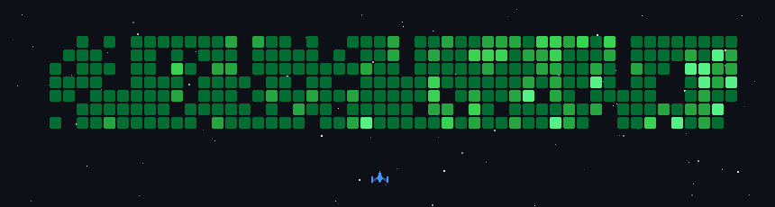

**Yuu Otosaka** · Full Stack Developer · Cambodia 🇰🇭

[

  <strong style="font-size: 24px;">💫 About Me</strong>

 🌱 I’m currently learning Next.js, React.js
  
 👯 I’m looking to collaborate on [PEACHY](https://peachygang.app) 💬 Ask me about HTML, CSS, JavaScript, Discord.js, MongoDB 📫 How to reach me peachydeveloper@gmail.com 

**🌐 Socials**

 
 

  <strong style="font-size: 24px;">🧰 Tech stack</strong>

**Languages**

**Frontend**

**Backend**

**Databases**

**DevOps & Tools**

**UX/UI**

<!-- ## 📊 GitHub stats

 -->

# 📊 GitHub stats 

 
 

# 🚀 My Contributions

<!-- ## 🐍 Snake eating my contributions

<picture>
  <source media="(prefers-color-scheme: dark)" srcset="https://raw.githubusercontent.com/yuuslokrobjakkroval/yuuslokrobjakkroval/output/github-snake-dark.svg" />
  <source media="(prefers-color-scheme: light)" srcset="https://raw.githubusercontent.com/yuuslokrobjakkroval/yuuslokrobjakkroval/output/github-snake.svg" />
  
</picture>

 -->

---

## 💬 Let's connect

Have a project in mind or just want to say hi? Reach me through my [portfolio](https://thoeurnrothanak.tech/?utm_source=github&utm_medium=readme).

⭐ If you find my work useful, a star on a repo goes a long way — thank you!

